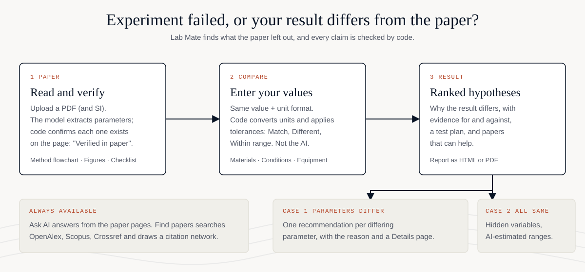

<p align="center">
  
</p>

<h3 align="center">Experiment failed, or your result differs from the paper?</h3>

<p align="center">
  Lab Mate reads the paper, links every extracted parameter to the exact source text (checked by code),<br>
  compares your values with the paper's, and ranks the likely reasons your result differs.
</p>

<p align="center">
  
  
  
  
</p>

<p align="center">
  <a href="#quick-start">Quick start</a> &middot;
  <a href="#demo-video">Demo video</a> &middot;
  <a href="#how-it-works">How it works</a> &middot;
  <a href="#features">Features</a> &middot;
  <a href="#privacy">Privacy</a>
</p>

## Demo video

<p align="center">
  <a href="https://youtu.be/k4JPXF7u41Q">
    
  </a>
  <br>
  <sub>Click to watch: <b>LabMate | Your Experimental Research Companion</b></sub>
</p>

## How it works

<p align="center">
  
</p>

1. **Paper.** Upload a PDF (and its supplementary information). The model extracts parameters; code checks that each one exists on the cited page.
2. **Compare.** Enter your own values. Code, not the AI, converts units, applies tolerances and decides what differs.
3. **Result.** If parameters differ, you get one recommendation per parameter. If everything matches, you get hidden variables the paper never mentions, with AI-estimated ranges and papers that discuss them.

## Features

| | |
|---|---|
| **Verified extraction** | Every parameter links to the exact source text on the page; unverified items are labelled. |
| **Deterministic comparison** | Unit conversion, tolerances, ranges. No model involved. |
| **Ranked hypotheses** | Evidence for and against, a test plan, and the data you should collect next. |
| **Per-parameter advice** | A short recommendation and reason for each differing parameter, with a Details page. |
| **Hidden variables** | What the paper leaves out, with ranges labelled as AI estimates. |
| **Method flowchart and figures** | The paper's method as steps; Methods and Results figures cropped from the PDF. |
| **Find papers** | OpenAlex, Scopus and Crossref search, citation network, keyword co-occurrence. |
| **Ask AI** | Answers only from the paper pages; anything else is labelled "Not from the paper". |
| **Reports** | Save the result as a self-contained HTML or PDF file for your lab notebook. |
| **Scanned PDFs** | OCR fallback for image-only pages (installed automatically on first run). |

## Quick start

```
git clone https://github.com/naeembayaksud-ship-it/lab-mate
cd lab-mate
python run.py
```

No terminal? After downloading the repo, double-click `install.bat` (Windows) or `install.command` (macOS; on Linux run `./install.command`). Both just run `python run.py`.

Needs Python 3.9 or newer and an internet connection on the first run. `python run.py` installs everything by itself:
`pypdf`, plus `pymupdf`, `Pillow` and `rapidocr-onnxruntime` for scanned-PDF OCR and the Figures tab. If your Python is 3.13
or newer (no OCR builds exist yet), it creates a small helper environment with Python 3.12 in `.labmate_aux/` (using `uv`,
which downloads Python itself). Then your browser opens at http://127.0.0.1:8650.

Next, click **Settings** (top bar), paste your own API key (Anthropic, or any OpenAI-compatible service such as OpenAI,
Gemini, OpenRouter or a local Ollama) or choose Hermes sign-in, press **Test connection**, then **Save**.

If an install step fails, the app still starts without OCR/Figures; retry with `python run.py --install`.
"Save PDF" needs Edge or Chrome installed (Lab Mate warns if none is found).

## Tools and services Lab Mate uses
Installed automatically by `python run.py` (internet needed on the first run):

| Tool | Used for | Needs |
|---|---|---|
| `pypdf` | Reading the text layer of PDFs | installed automatically |
| `pymupdf`, `Pillow` | Cropping figures, rendering pages for OCR | installed automatically (helper Python 3.12 environment on Python 3.13+) |
| `rapidocr-onnxruntime` | OCR of scanned pages | installed automatically |
| `uv` | Creates the helper environment when your Python is 3.13+ | installed automatically only if needed |

Online services (called with plain HTTPS, no extra package):

| Service | Used for | Key |
|---|---|---|
| Crossref | DOI lookup, abstracts, reference lists for the citation graph | none |
| OpenAlex | Paper search and keyword counts | none; free `OPENALEX_API_KEY` raises the daily limit |
| Scopus (Elsevier) | More paper search and counts | optional `SCOPUS_API_KEY` |
| Your model provider | Reading, hypotheses, recommendations, Ask AI | Anthropic key, OpenAI-compatible key (OpenAI, Gemini, OpenRouter, Ollama) or Hermes sign-in, set in Settings |

Not installed by Lab Mate: Edge or Chrome (for Save PDF) and Hermes (only if you choose the Hermes provider).
Without Scopus, Find papers uses OpenAlex and Crossref only.

## Agent skill
`skills/lab-mate/SKILL.md` teaches a coding agent (Claude Code and similar) to follow the same Paper, Compare, Result order through the local API.
Copy the folder to `~/.claude/skills/lab-mate` to use it.

## Privacy
With a cloud provider, the paper text is sent to that provider. Use a local model (Ollama) for unpublished or confidential
papers. Lab Mate recommends only; it never runs an experiment or a simulation.

## What is in the repo

```
run.py              one-command launcher (any OS)
requirements.txt    required + optional packages
.env.example        environment variables the app understands
app/                the application: server.py, logic.py, llm.py, index.html (single-file UI), assets/
tests/              UI smoke test, accessibility audit, screenshot helper (need Edge or Chrome)
skills/             agent skill that follows the website flow
docs/               logo and the how-it-works figure used in this README
examples/           fictional papers and sample "my experiment" files to try it with
```

## Try it without your own data
Upload `examples/demo_paper_aspirin.pdf`, open Compare, and enter the values from `examples/user_A_temperature_mistake.json`
(water bath 60 C instead of 75 C) or `user_B_all_same_low_yield.json` (everything matches, yield is still low). A harder
fictional paper with planted causes is in `examples/silver_nanoparticles/`. All example data is fictional; see `examples/README.md`.

## Development
```
python run.py --no-browser          # server only
python tests/smoke.py <project-id>  # clicks through the UI in headless Edge (server must be running)
```
Optional search keys: Scopus (`~/.config/pybliometrics.cfg`) and `OPENALEX_API_KEY`. Without them, Find papers uses the free
OpenAlex and Crossref APIs, and OpenAlex may hit its daily limit.

## Known limits
- Hypothesis quality depends on the model you connect. A small local model may return invalid JSON.
- Keyword percentages are title/abstract co-occurrence, not the size of a variable's effect.
- Hidden-variable ranges are AI estimates and are labelled as such.
- Save PDF needs Edge or Chrome (set `PDF_BROWSER` for another path). Tested on Windows; macOS and Linux are untested.

## Papers and data
Papers you upload keep their own rights.

## Running the tests (optional)
`pip install aiohttp`, have Edge or Chrome installed, then run the scripts in `tests/` (they were written and tested on Windows).
